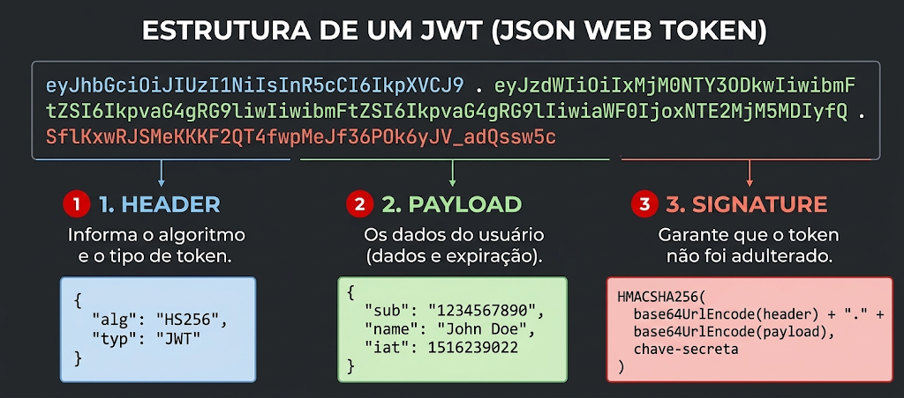

# BCRYPT

A **bcrypt** é uma biblioteca de criptografia de senhas (hashing) projetada para transformar senhas em texto puro numa cadeia de carateres irreversível (*hash*) antes de serem guardadas numa base de dados.

### Principais Características

* **Unidirecional (Hash):** O processo não pode ser revertido. Para validar o acesso, o algoritmo gera o *hash* da senha introduzida no login e compara-o com o *hash* guardado na base de dados.
* **Salting Automático:** Adiciona carateres aleatórios (*salt*) à senha antes de gerar o *hash*. Isto garante que dois utilizadores com a mesma senha (ex: `123456`) tenham *hashes* completamente diferentes, protegendo o sistema contra ataques de *Rainbow Table*.
* **Fator de Custo Exponencial (*Work Factor* / *Salt Rounds*):** Permite definir o quão lento será o cálculo da senha ($2^{\text{rounds}}$ iterações). Por padrão, utiliza-se o valor `10` ($1024$ iterações), que oferece equilíbrio entre segurança e desempenho (~100ms por operação).
* **Proteção Contra Força Bruta:** Por ser intencionalmente lenta e consumir memória, inviabiliza que invasores testem milhões de senhas por segundo com placas gráficas (GPUs) potentes.

---

### Exemplo de Uso no Node.js

```javascript
import bcrypt from 'bcrypt';

// 1. No Cadastro: Criptografar a senha
const senhaLimpa = 'MinhaSenha123';
const hashSenha = await bcrypt.hash(senhaLimpa, 10);
// Resultado retornado: $2b$10$EixZaYVK1fsbw1ZfbX3OXePaWxn96p36WQoeG6Lruj3vjPGga31lW

// 2. No Login: Comparar a senha fornecida com o hash guardado
const senhaDigitada = 'MinhaSenha123';
const senhaValida = await bcrypt.compare(senhaDigitada, hashSenha); // Retorna true ou false

```


## 🛡️ Entendendo o Salt no bcrypt

Um dos principais recursos de segurança do **bcrypt** é a geração automática de **Salt** (sal). 

### O que é o Salt?
O *Salt* é uma string aleatória única gerada antes do processo de hashing. Ele é combinado com a senha do usuário antes de a função de hash ser aplicada.

### Por que o Salt é indispensável?

1. **Prevenção contra Rainbow Tables (Tabelas Pré-computadas):**
   Ataques de *Rainbow Table* utilizam bancos de dados gigantescos com hashes pré-calculados de senhas comuns (ex: a palavra `"123456"` geraria sempre o mesmo hash MD5/SHA256). Com o Salt, o resultado final do hash muda drasticamente para cada usuário, tornando essas tabelas inúteis.

2. **Diferenciação de Senhas Identicas:**
   Se dois usuários cadastrarem a exata mesma senha (ex: `"Senha123"`), o bcrypt gerará um *Salt* diferente para cada um. Como resultado, os hashes salvos no banco de dados serão totalmente distintos.

---

### Como o Salt é Estruturado no Hash Final?

Quando o `bcrypt.hash()` é executado, o Salt gerado é embutido diretamente dentro do próprio hash final. Por essa razão, não é necessário salvar o Salt em uma coluna separada no banco de dados.

Um hash do bcrypt segue a estrutura abaixo:

`$2b$10$EixZaYVK1fsbw1ZfbX3OXePaWxn96p36WQoeG6Lruj3vjPGga31lW`

* **`$2b$`**: Identificador do algoritmo (bcrypt).
* **`$10$`**: Fator de Custo (*Cost Factor* / *Salt Rounds*).
* **`EixZaYVK1fsbw1ZfbX3OXeP`**: O **Salt** de 22 caracteres gerado aleatoriamente.
* **`aWxn96p36WQoeG6Lruj3vjPGga31lW`**: O hash real resultante da combinação da senha + salt.

---

### O Fator de Custo (Salt Rounds)

Ao gerar o salt com `bcrypt.genSalt(10)` ou `bcrypt.hash(senha, 10)`, o número **10** define a complexidade do algoritmo:

* A escala é **exponencial** ($2^{\text{rounds}}$ iterações).
* **10 rounds** (padrão) = $2^{10} = 1.024$ iterações de hashing (~100ms de execução).
* **12 rounds** = $2^{12} = 4.096$ iterações (~400ms, recomendado para alta segurança).

Esse atraso computacional intencional protege o sistema contra ataques de **força bruta**, pois impede que hackers testem milhões de combinações por segundo via GPU.

### Qual é o valor ideal?
* 10 (Padrão e Recomendado): Oferece um excelente equilíbrio. Leva cerca de 100ms para processar no servidor. O usuário não sente atraso ao fazer login, mas é lento o suficiente para travar hackers.
* 12: Ideal para sistemas que exigem alta segurança (bancos, dados médicos). Demora cerca de 300ms a 500ms.
* < 8: Muito fraco para os padrões atuais de computação.
* > 15: Deixa o servidor extremamente lento. Cada login pode demorar vários segundos ou travar o Node.js.

Aqui tens uma secção detalhada sobre **JWT (JSON Web Token)**, pronta e formatada em Markdown para adicionares diretamente ao teu `README.md`:


# JSON Web Token (JWT)

O **JWT (JSON Web Token)** é um padrão da indústria (RFC 7519) utilizado para autenticar e partilhar informações de forma segura entre o cliente (frontend/mobile) e o servidor (backend) através de uma estrutura de dados compacta e auto-contida.

Ao contrário do modelo tradicional de sessões baseadas em memória no servidor, o JWT é **stateless** (sem estado): toda a informação necessária para identificar o utilizador já está contida dentro do próprio token.

---

### Estrutura de um JWT

Um JWT é uma string composta por três partes separadas por pontos (`.`):

`header.payload.signature`

1. **Header (Cabeçalho):**
   Contém o tipo do token (`JWT`) e o algoritmo de assinatura utilizado (como `HS256` ou `RS256`).
   
2. **Payload (Carga de dados):**
   Guarda as informações do utilizador (conhecidas como *claims*), tais como o ID do utilizador, o email ou as suas permissões, além do tempo de expiração do token (`exp`).
   > ⚠️ **Atenção:** Os dados do payload são apenas codificados em Base64URL e **não são encriptados**. Nunca deves guardar informações sensíveis como palavras-passe ou dados bancários no payload.

3. **Signature (Assinatura):**
   Garantia de integridade do token. É gerada combinando o *Header* codificado, o *Payload* codificado e uma **chave secreta** (`SECRET_KEY`) mantida apenas no servidor. Se alguém alterar o conteúdo do payload no cliente, a assinatura torna-se inválida e o servidor rejeita a requisição.

---



### Fluxo de Autenticação com JWT

1. **Login:** O cliente envia as credenciais (email e palavra-passe) para a API.
2. **Geração:** O servidor valida os dados e gera um JWT assinado com a sua chave secreta.
3. **Envio:** O servidor devolve o token na resposta.
4. **Armazenamento:** O cliente guarda o token (ex: no `localStorage` ou em `Cookies HttpOnly`).
5. **Requisição Autorizada:** Nas requisições seguintes para rotas protegidas, o cliente envia o token no cabeçalho (*Header*) da requisição:
   `Authorization: Bearer <TOKEN_JWT>`
6. **Validação:** O servidor verifica a assinatura do token. Se for válida, processa a requisição sem precisar de consultar a base de dados para validar a sessão.

---

### Exemplo Prático de Uso no Node.js (`jsonwebtoken`)

#### 1. Instalação
```bash
npm install jsonwebtoken

```

#### 2. Gerar o Token no Login

```javascript
import jwt from 'jsonwebtoken'

// Dados a incluir no token
const payload = { userId: user.id, email: user.email }
const secretKey = process.env.JWT_SECRET || 'chave_secreta_super_segura'

// Gera o token com validade de 1 dia
const token = jwt.sign(payload, secretKey, { expiresIn: '1d' })

```

#### 3. Proteger Rotas com Middleware

```javascript
import jwt from 'jsonwebtoken'

function checkToken(req, res, next) {
    const authHeader = req.headers['authorization']
    const token = authHeader && authHeader.split(' ')[1] // Remove a palavra 'Bearer'

    if (!token) {
        return res.status(401).json({ message: 'Acesso negado! Token não fornecido.' })
    }

    try {
        const secretKey = process.env.JWT_SECRET || 'chave_secreta_super_segura'
        const decoded = jwt.verify(token, secretKey)
        
        req.userId = decoded.userId // Injeta os dados do utilizador na requisição
        next()
    } catch (error) {
        return res.status(403).json({ message: 'Token inválido ou expirado.' })
    }
}

```

### Principais Vantagens

* **Escalabilidade (Stateless):** O servidor não precisa de guardar sessões na memória ou em base de dados.
* **Segurança de Integridade:** Impossível para o cliente adulterar os dados sem invalidar a assinatura.
* **Suporte Cross-Domain:** Funciona perfeitamente entre diferentes domínios e microsserviços.


# Middlewares
Um **middleware** é uma função que fica **no meio do caminho** entre a requisição (*request*) feita pelo cliente e a resposta final (*response*) enviada pelo servidor Express.

O middleware funciona como um **posto de controlo** ou um **segurança de uma discoteca**: antes de deixar o cliente chegar à rota final (ex: ver a lista de usuários ou fazer uma compra), a requisição tem que passar por um ou mais middlewares para ser inspecionada, tratada ou validada.

---

### Como funciona no Express?

Uma função de middleware tem acesso a três parâmetros principais:

1. `req`: O objeto da requisição (contém os dados enviados pelo cliente).
2. `res`: O objeto da resposta (usado para responder ao cliente se algo estiver errado).
3. `next`: Uma função que passa a execução para o **próximo** middleware ou para a rota final.

Se o middleware não chamar a função `next()`, a requisição fica parada (*hangs*) e o cliente nunca recebe resposta.

---

### Casos de uso mais comuns de um Middleware

1. **Tratamento de Dados (Parsing):**
* Exemplo: `app.use(express.json())`
* O que faz: Converte o texto JSON enviado no corpo da requisição (*body*) num objeto JavaScript acessível via `req.body`.


2. **Autenticação e Proteção de Rotas:**
* Verifica se a requisição traz um **JWT válido** no cabeçalho (*Header*). Se o token for válido, chama `next()`; se for inválido, devolve um erro `401 Unauthorized` de imediato.


3. **Logs e Auditoria:**
* Regista no terminal detalhes de cada requisição que chega (ex: horário, método HTTP `GET`/`POST` e URL acessado).


4. **Validação de Dados:**
* Confirma se o email enviado no cadastro tem um formato válido ou se a senha atende aos requisitos mínimos antes de chamar a base de dados.


---

### Exemplo Prático no Código

```javascript
import express from 'express'
const app = express()

// 1. Middleware Global: executa em TODAS as requisições
app.use((req, res, next) => {
    console.log(`[LOG] Requisição ${req.method} feita para o URL: ${req.url}`)
    next() // 👈 Passo essencial para permitir que a requisição continue!
})

// 2. Middleware Customizado: Autenticação
function authMiddleware(req, res, next) {
    const token = req.headers['authorization']
    
    if (!token) {
        return res.status(401).json({ message: 'Acesso negado! Token ausente.' })
    }
    
    // Se o token for válido, avança
    next()
}

// 3. Rota Protegida usufruindo do Middleware
app.get('/admin', authMiddleware, (req, res) => {
    res.json({ message: 'Bem-vindo ao painel de administração!' })
})

```

